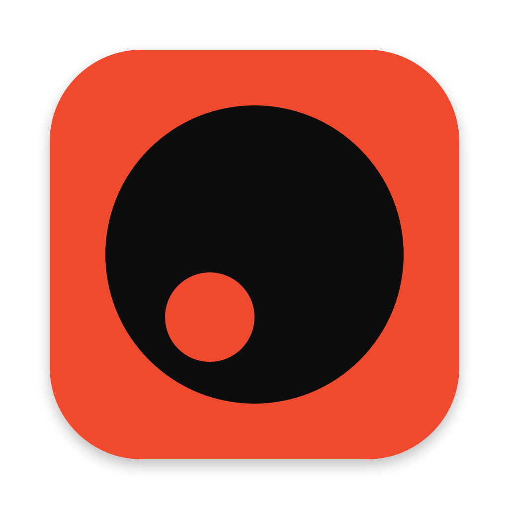
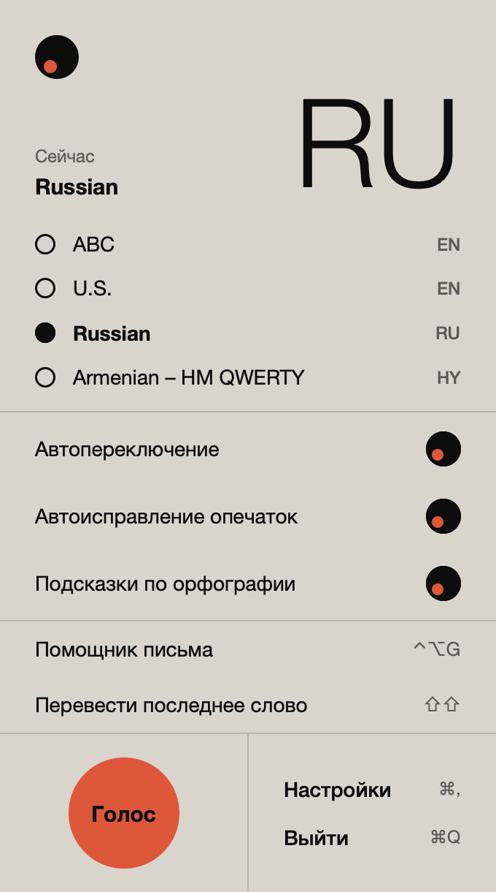
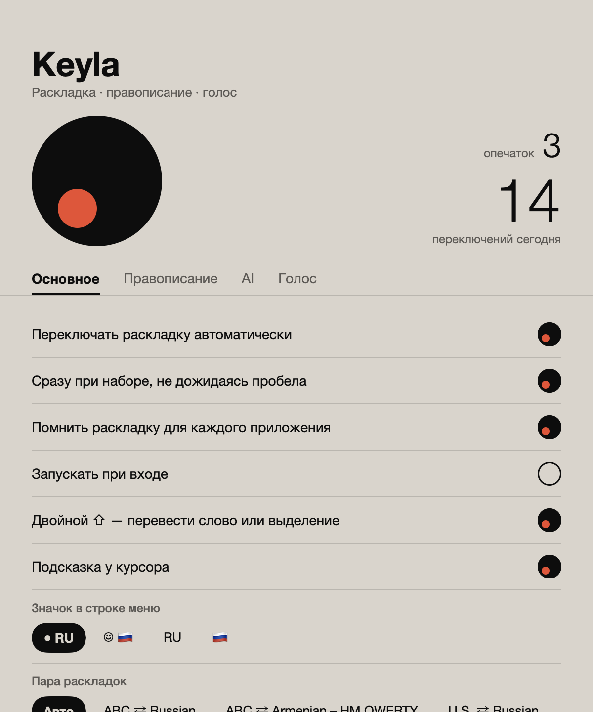
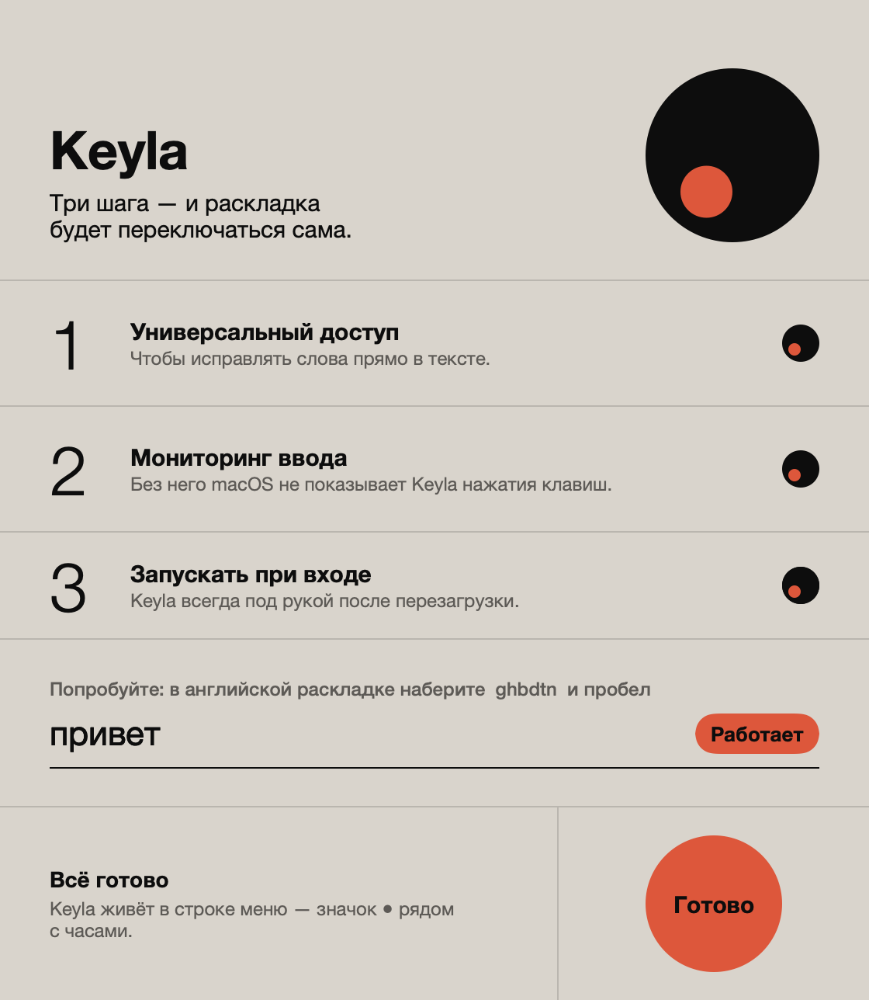
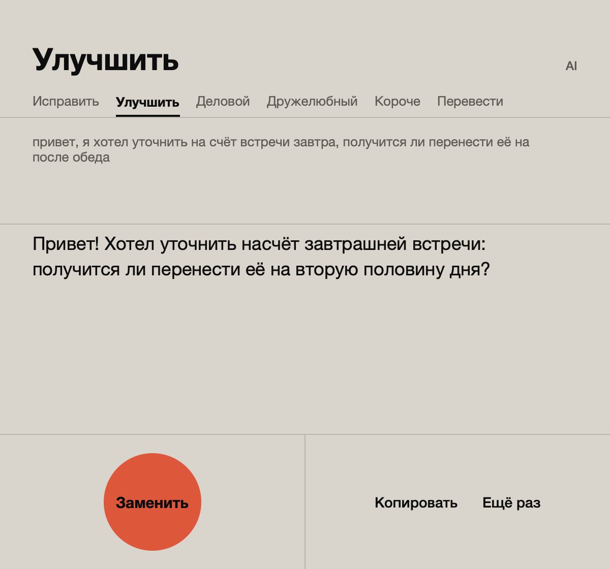

<p align="center"></p>

<h1 align="center">Keyla</h1>

<p align="center">Раскладка, правописание и голос для macOS — в одном значке строки меню.<br>
<sub>Auto keyboard-layout switcher, spell & grammar helper, AI writing assistant and voice typing for macOS.</sub></p>

<p align="center"><a href="https://github.com/RAZ-AR/keyla/releases/latest"><b>⬇ Скачать Keyla.dmg</b></a></p>

<p align="center">
  
  &nbsp;
  
</p>

## Что умеет

| | |
|---|---|
| **Автопереключение раскладки** | Прямо во время набора: на третьей букве `ghb` уже становится `при…`, и раскладка переключена. Короткие слова тоже: `yt` → «не», `xnj` → «что», а одиночное `z` перед словом исправляется вместе с ним («я привет»). Учитывается язык соседних слов. Работает с любыми включёнными раскладками. |
| **Учится на вас** | **⌫** сразу после исправления — вернуть как было. **Двойной Shift** на слове, которое Keyla пропустила, — и она выучит его. Язык предыдущего слова помогает решать спорные случаи. |
| **Мои слова** | Отменили исправление или несколько раз написали слово, которого нет в словарях (армянское латиницей или кириллицей, жаргон, имя), — Keyla предложит **«Запомнить»**. Такие слова она больше не переключает, не исправляет и не подчёркивает, и их перестаёт подчёркивать macOS в других программах. Список — Настройки → Правописание. |
| **Двойной Shift** | Перевести текущее / последнее слово или **выделенный текст** в другую раскладку. |
| **Раскладка для каждого приложения** | Telegram — RU, Xcode — EN: Keyla помнит, где какую раскладку вы использовали, и включает её при переключении окна. |
| **Запуск при входе** | Включается при первом запуске, выключается в настройках или в Системных настройках → Основные → Объекты входа. |
| **Индикатор** | Знак Keyla и код языка в строке меню; подсказка рядом с курсором при смене раскладки. |
| **Правописание** | Слово с ошибкой подчёркивается прямо в тексте — нажмите на него и выберите вариант. По желанию автоисправление опечаток; проверка грамматики законченных предложений. |
| **Помощник письма ⌃⌥G** | Выделите текст → «Исправить», «Улучшить», «Деловой», «Дружелюбный», «Короче», «Перевести» → «Заменить». **Apple Intelligence на устройстве — без ключей и интернета** (macOS 26+), Claude или любая OpenAI-совместимая модель (Ollama, LM Studio, OpenRouter). |
| **Обновления** | Keyla сама проверяет новые версии; обновление в один клик из меню, с проверкой контрольной суммы и подписи. |
| **Голос** | Удерживайте **правый ⌥** (или ⌃⌥V) и говорите. Распознавание: Apple на устройстве, Whisper API или **whisper.cpp полностью локально**. |

<p align="center">&nbsp;</p>

## Установка

1. Скачайте `Keyla-x.y.z.dmg` из [Releases](https://github.com/RAZ-AR/keyla/releases/latest), откройте и перетащите **Keyla** в **Программы**.
2. **Первый запуск.** Keyla не нотаризована Apple, поэтому macOS её сначала заблокирует. Откройте **Системные настройки → Конфиденциальность и безопасность** и нажмите **«Всё равно открыть»** у Keyla. Или в Терминале:
   ```bash
   xattr -dr com.apple.quarantine /Applications/Keyla.app
   ```
3. При первом запуске откроется приветствие: три шага с живыми галочками — **Универсальный доступ**, **Мониторинг ввода** и запуск при входе — и поле, где можно сразу попробовать. Без «Мониторинга ввода» macOS не показывает Keyla нажатия клавиш.
4. Для диктовки macOS отдельно спросит доступ к **Микрофону** и **Распознаванию речи**.

> **Не запускайте одновременно с Punto Switcher** — оба будут исправлять одни и те же слова.
> Если Keyla перестала реагировать и в меню видно 🔒 «Защищённый ввод» — его держит другая программа (Keyla назовёт какая). Закройте её. Если это `loginwindow`, поможет только перезагрузка или выход из учётной записи.

## Модели

**Письмо:** по умолчанию — Apple Intelligence прямо на Mac (нужна macOS 26 и включённый Apple Intelligence). Для длинных текстов: Настройки → AI → Claude и ключ Anthropic. Или «Своя» и адрес `http://localhost:11434/v1` для Ollama.

**Голос локально (whisper.cpp):**
```bash
brew install whisper-cpp
curl -L -o ~/ggml-large-v3-turbo.bin https://huggingface.co/ggerganov/whisper.cpp/resolve/main/ggml-large-v3-turbo.bin
```
Затем Настройки → Голос → whisper.cpp и укажите файл модели.

## Сборка из исходников

Нужны macOS 14+ и Xcode Command Line Tools.

```bash
./build.sh --install     # собрать Keyla.app и поставить в /Applications
./make-dmg.sh            # собрать dist/Keyla-<версия>.dmg
swift build && .build/debug/Keyla --selftest           # проверки определения раскладки, без разрешений
.build/debug/Keyla --apple-write "текст"                # проверить модель Apple на устройстве
.build/debug/Keyla --snapshots design/snapshots         # отрисовать все экраны в PNG
```

`build.sh` подписывает приложение сертификатом «Keyla Local Signing», если он есть в Связке ключей, иначе — ad-hoc. С постоянным сертификатом macOS не сбрасывает разрешения после каждой пересборки.

### Нотаризация

С аккаунтом Apple Developer релиз можно подписать Developer ID и нотаризовать — тогда macOS не показывает предупреждение при первом запуске. Инструкция в начале [`notarize.sh`](notarize.sh):

```bash
KEYLA_TEAM_ID=ABCDE12345 ./notarize.sh
```

Чтобы автообновление приняло новую подпись, сначала выпустите одну версию со старой подписью, но с `KEYLA_TEAM_ID=… ./make-dmg.sh` — она запомнит команду, которой можно доверять.

## Устройство

- `KeyboardEngine.swift` — системный перехват клавиш (CGEventTap), слово из кодов клавиш, авто- и ручная конвертация, отмена.
- `Layouts.swift` — таблицы символов из настоящих раскладок macOS (UCKeyTranslate).
- `Detector.swift` — «не та раскладка» (целые слова, префиксы на лету, короткие слова) + орфография и грамматика (NSSpellChecker).
- `InlineMarks.swift` — подчёркивание ошибок в тексте и исправление по клику. `AppleModel.swift` — Apple Intelligence. `Updater.swift` — обновления.
- `LLM.swift`, `Writer.swift` — помощник письма. `Voice.swift` — запись и три движка распознавания.
- `Theme.swift` — дизайн-система: сигнальный `#EF4A2E`, чёрный, бумага `#DAD4CB`, Helvetica Neue, круги.
- `MenuPanel.swift`, `SettingsView.swift`, `HUD.swift` — интерфейс.

Ключи API хранятся в Связке ключей и никуда, кроме выбранного провайдера, не отправляются.

## Лицензия

MIT
